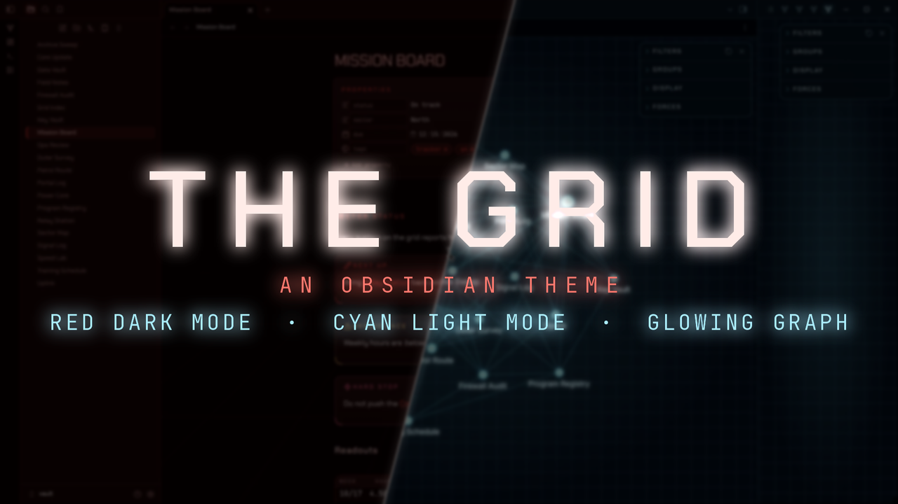
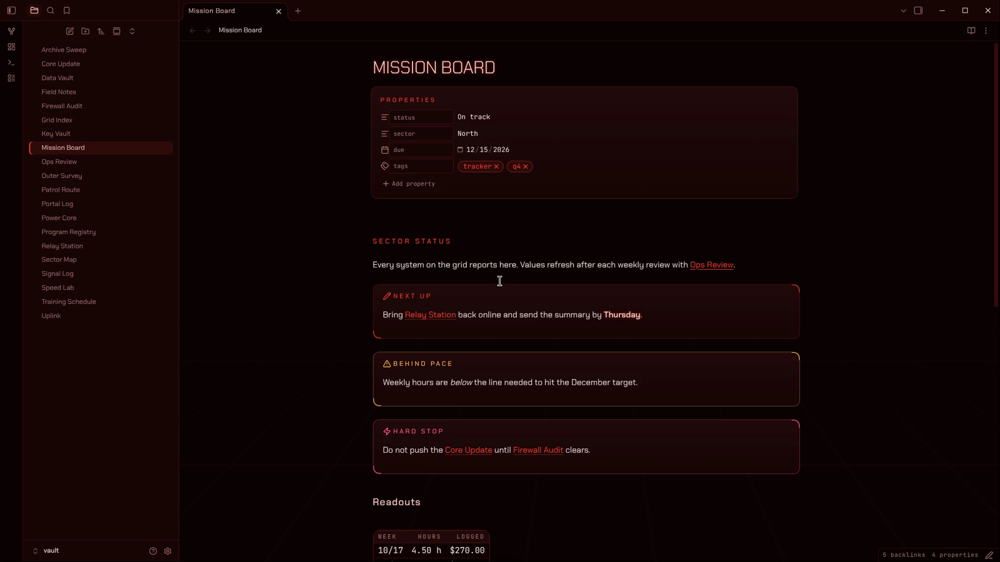
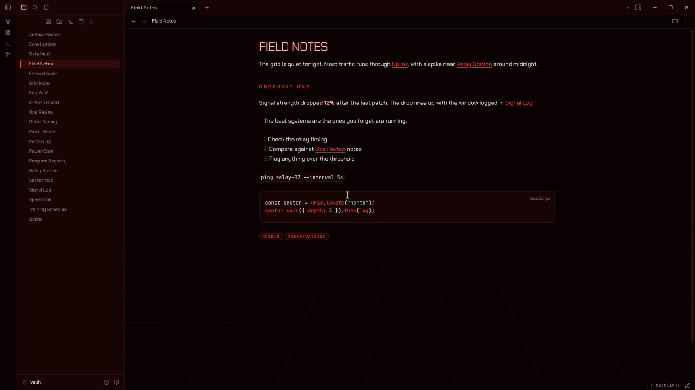
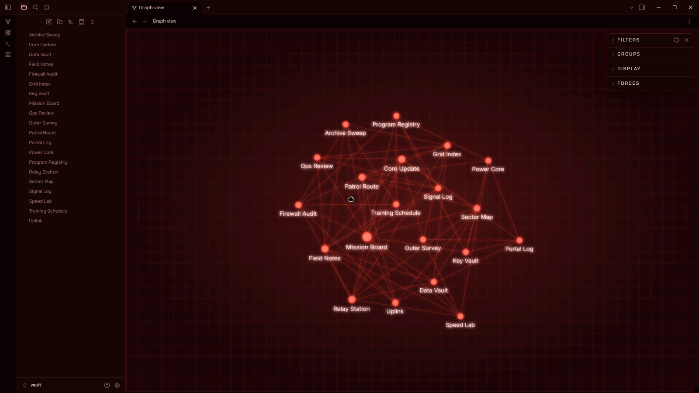
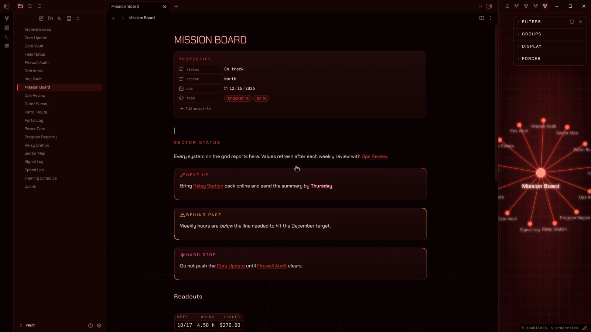
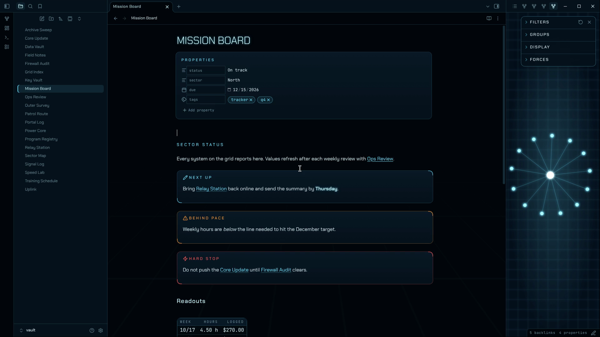
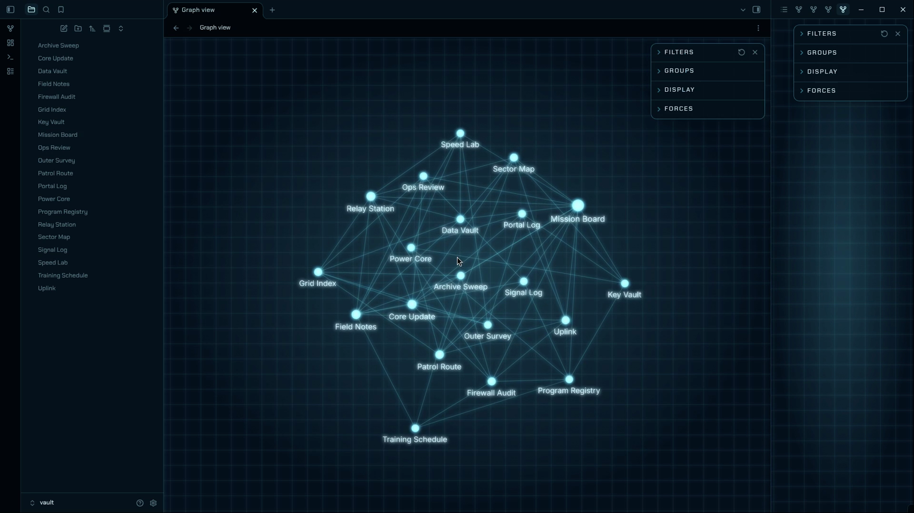

The Grid is a mission-control theme for [Obsidian](https://obsidian.md/). Your notes sit on a near-black void with a perspective grid floor that fades in from the bottom, and headings, links and live values glow. Dark mode runs **red**. Light mode runs **cyan**. Both stay dark. Tune the grid, the glow and the type with the optional [Style Settings](https://community.obsidian.md/plugins/obsidian-style-settings) plugin.

## About The Grid

- [Screenshots](#screenshots)
- [Installation](#installation)
- [Companion plugins](#companion-plugins)
- [Settings](#settings)
- [Color schemes](#color-schemes)
- [What it styles](#what-it-styles)
- [Plugin support](#plugin-support)
- [Performance](#performance)
- [Contributing](#contributing)
- [License](#license)
- [Disclaimer](#disclaimer)

## Screenshots

**Dark mode** runs hot red on a black-red void, with callouts, properties and tables built like instrument panels

**Code, quotes and lists** stay readable, with mono type for data and code

**Graph view** glows on a flat grid, with bright nodes, lit links and readable labels

**Local graph** glows in the sidebar beside the note you're working on

**Light mode** switches the whole theme to cool cyan and stays dark

## Installation

To install the theme

- Open Obsidian Settings
- Go to `Appearance` and click `Manage` next to Themes
- Search for "The Grid" and click `Install and use`

To install the companion plugin (optional)

- Go to `Community plugins` and turn off `Restricted mode`
- Click `Browse`, search for "Style Settings", then click `Install` and `Enable`
- Open Settings and find **The Grid** under `Style Settings`

Found a bug or have an idea? [Open an issue](https://github.com/mkenway01-cloud/obsidian-the-grid/issues).

## Companion plugins

- [Style Settings](https://github.com/mgmeyers/obsidian-style-settings) gives you switches and sliders for the options below. The theme works fully without it.

## Settings

These settings appear under **The Grid** in the Style Settings plugin.

### Backdrop

- **Hide the grid floor:** turns off the perspective grid behind your notes
- **Animate the grid:** lets the grid drift slowly toward you. It stays still if your system asks for reduced motion.
- **Grid strength:** sets how visible the grid is, from faint to bold

### Graph view

- **Turn off graph glow:** removes the glow on nodes and links
- **Hide the graph grid:** removes the flat grid behind the graph and local graph

### Type and glow

- **Turn off text glow:** removes the soft glow on headings, bold text and checked boxes
- **Sentence-case headings:** keeps headings in the case you typed instead of uppercase
- **Use a plain body font:** sets running text in your system font. Headings and data keep The Grid fonts.
- **Readable line width:** sets the width of the text column in pixels

## Color schemes

The Grid follows Obsidian's own light and dark setting. Switch between them in **Settings → Appearance → Base color scheme**.

| Mode | Signal color | Background | Warnings |
| :--- | :--- | :--- | :--- |
| Dark | Red `#ff3b2f` | Black-red `#0b0203` | Amber `#ffb84d` |
| Light | Cyan `#6fe3ff` | Black-blue `#02060b` | Amber `#ff9d3c` |

Amber only appears when something crosses a line: warning callouts, highlights and caution states. It is never used as decoration.

## What it styles

- **Headings:** H1 is a wide, tracked title. H2 is a small uppercase section label with a hairline under it. H4 to H6 switch to a mono label style.
- **Callouts and quotes:** deck panels with corner brackets on the top-right and bottom-left. Warning-type callouts turn amber, and danger-type callouts get their own color.
- **Tags:** mono, uppercase pills.
- **Checkboxes:** rotated-square status diamonds that glow when checked.
- **Tables and properties:** set in JetBrains Mono with tabular figures, so numbers line up.
- **Graph view and local graph:** glowing nodes, links and labels on a flat grid.
- **Print and PDF export:** switches to dark text on white so pages print clean.

## Plugin support

Most plugins work with The Grid because it sets Obsidian's standard color and font variables. These plugins have been checked by hand:

- [Style Settings](https://github.com/mgmeyers/obsidian-style-settings)
- [Editing Toolbar](https://github.com/PKM-er/obsidian-editing-toolbar)

If a plugin looks out of place, [open an issue](https://github.com/mkenway01-cloud/obsidian-the-grid/issues) with a screenshot.

## Performance

The theme loads nothing from the internet. Chakra Petch and JetBrains Mono are built into `theme.css`, which makes the file larger than most themes but means it works offline.

The graph glow is a light bloom layer laid over the graph. On a very large vault or an older machine, turn it off in Style Settings if the graph feels slow.

## Contributing

Bug reports and suggestions are welcome through [GitHub issues](https://github.com/mkenway01-cloud/obsidian-the-grid/issues). Please include your Obsidian version, your operating system, and a screenshot of the problem.

## License

The theme code is released under the [MIT License](LICENSE).

The embedded fonts are licensed separately under the SIL Open Font License 1.1:

- Chakra Petch © The Chakra Petch Project Authors ([license](OFL-ChakraPetch.txt))
- JetBrains Mono © The JetBrains Mono Project Authors ([license](OFL-JetBrainsMono.txt))

## Disclaimer

The Grid is an independent community theme. It is not made, endorsed or supported by Obsidian. It is an original design and is not affiliated with any film, studio or brand.

The theme is provided as is, without warranty of any kind. Back up your vault before changing themes or settings.
