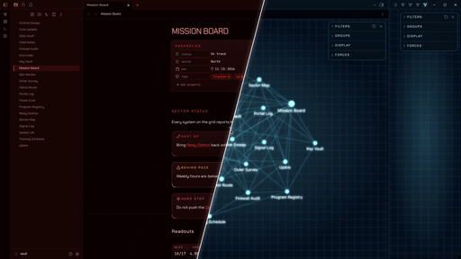

# The Grid

A mission-control theme for Obsidian. Your notes sit on a near-black void with a perspective grid floor that fades in from the bottom. Headings, links and live values glow. Dark mode runs **red**. Light mode runs **cyan**. Both stay dark.

## Two modes

- **Dark mode (red):** hot red signal on a black-red void.
- **Light mode (cyan):** cool cyan instruments on a black-blue void.

Switch between them with Obsidian's own setting: **Settings → Appearance → Base color scheme**.

## What it styles

- **Graph view and local graph:** nodes, links and labels glow on a flat grid.
- **Headings:** H1 is a wide, tracked title. H2 is a small uppercase section label with a hairline under it. H4 to H6 switch to a mono label style.
- **Callouts and quotes:** deck panels with corner brackets on the top-right and bottom-left. Warning-type callouts turn amber, and danger-type callouts get their own color.
- **Tags:** mono, uppercase pills.
- **Checkboxes:** rotated-square status diamonds that glow when checked.
- **Tables and properties:** set in JetBrains Mono with tabular figures, so numbers line up.
- **Print and PDF export:** switches to dark text on white.

## Settings

With the [Style Settings](https://github.com/mgmeyers/obsidian-style-settings) plugin you can:

- Hide the grid floor, animate it, or set its strength
- Turn off the graph glow or the graph grid
- Turn off text glow
- Use sentence-case headings
- Use a plain body font
- Set the readable line width

## Notes

- The theme loads nothing from the internet. Chakra Petch and JetBrains Mono are embedded in `theme.css`.
- The graph glow is a light bloom layer. If your machine struggles with a very large graph, turn it off in Style Settings.

## Credits and licenses

- Theme code: MIT, © 2026 Matthew Kenway.
- Chakra Petch © The Chakra Petch Project Authors. JetBrains Mono © The JetBrains Mono Project Authors. Both are licensed under the SIL Open Font License 1.1 (see the `OFL-*.txt` files).
